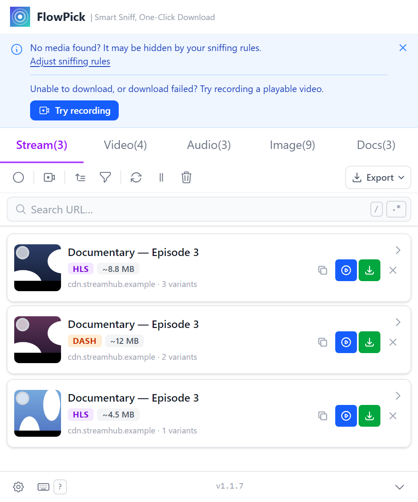
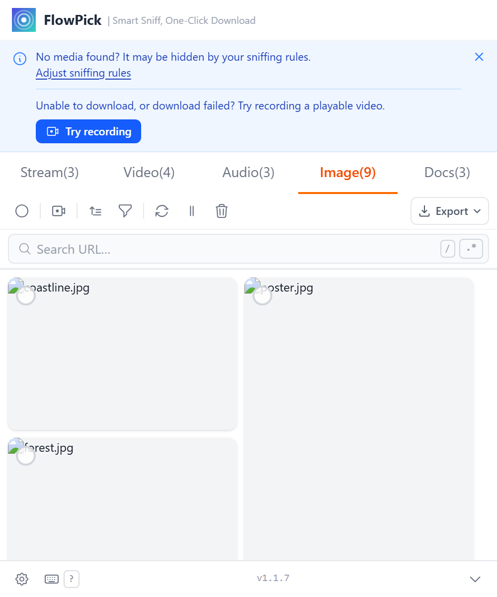
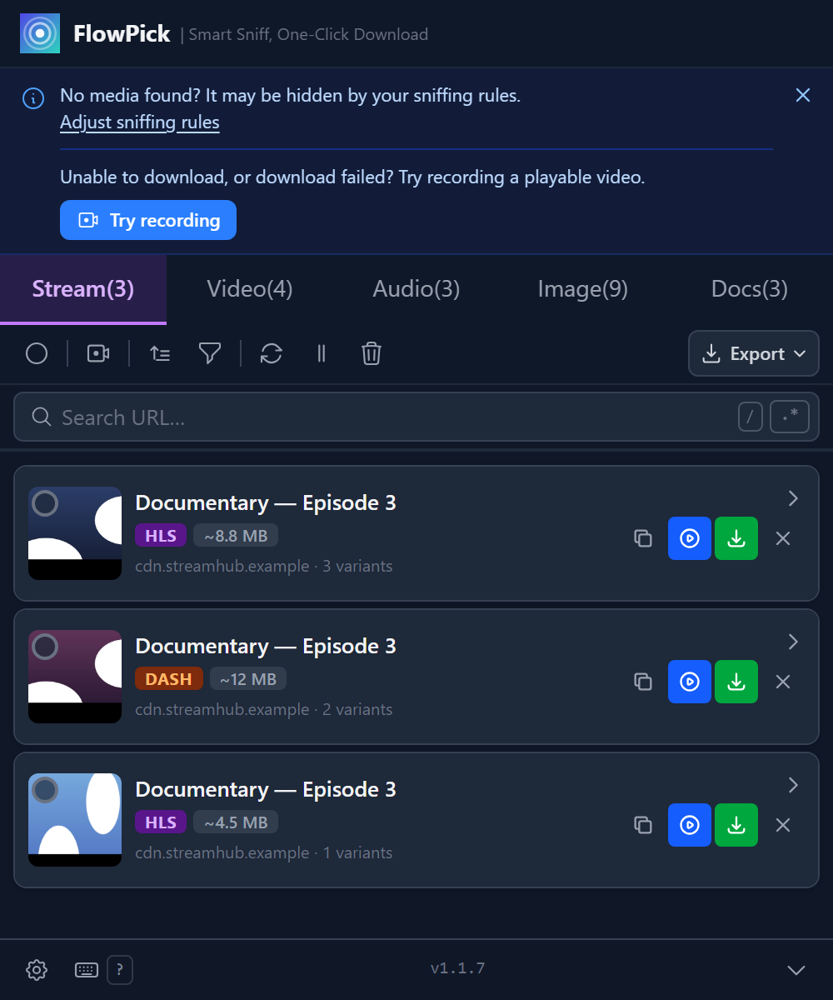
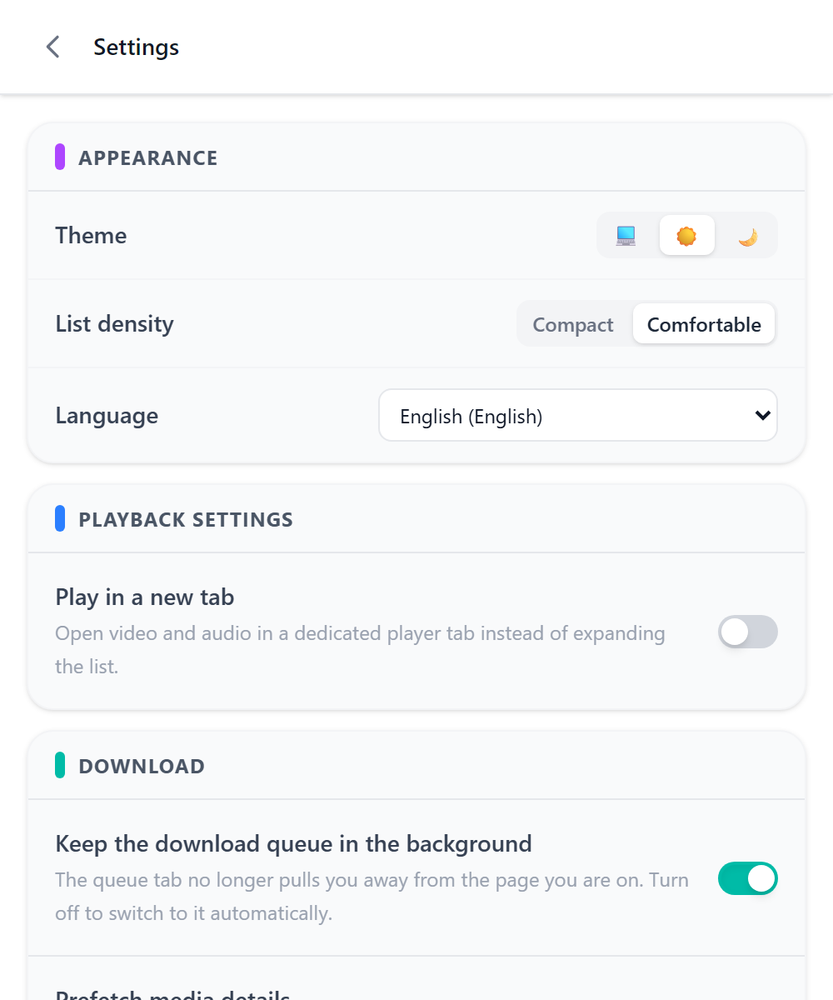
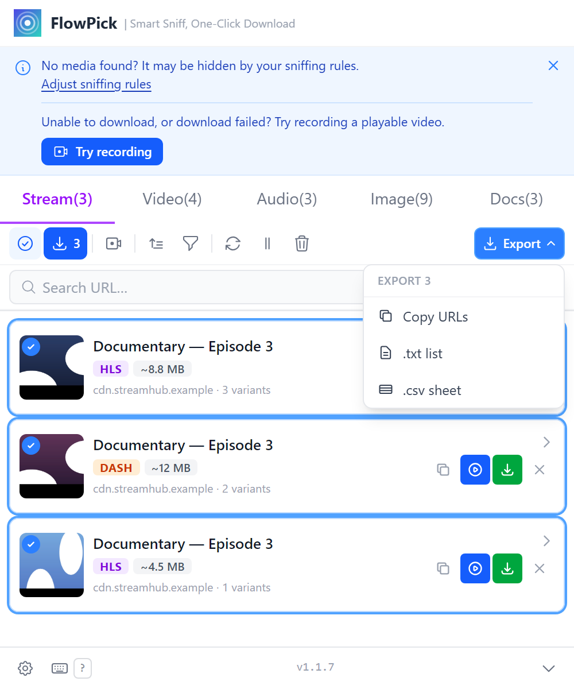
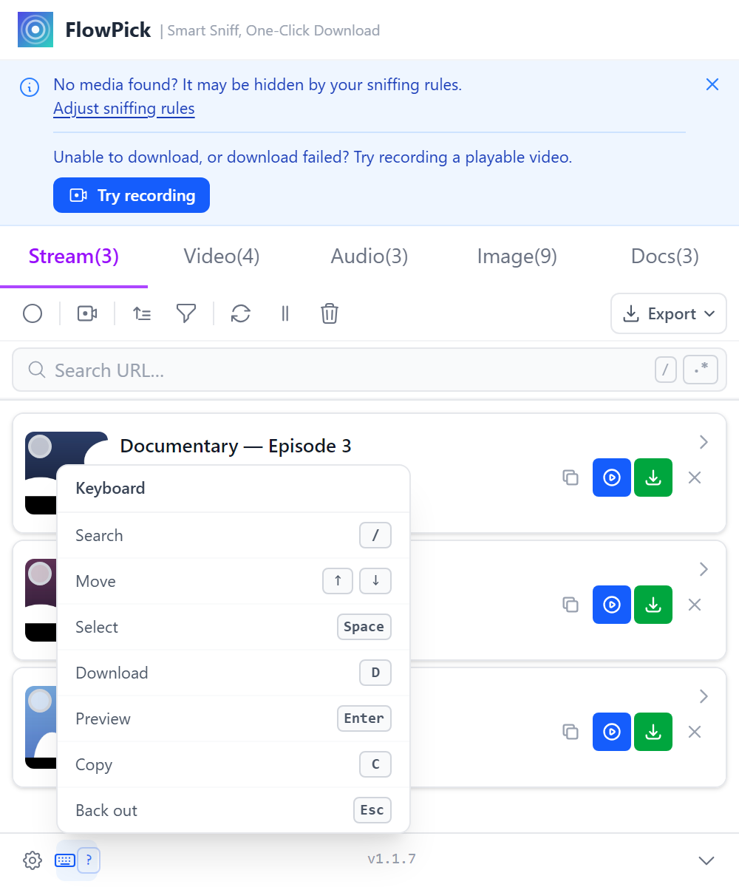

# 🌊 FlowPick

> **Smart Media Sniffer · Preview & Download** — Automatically capture video streams, audio, and images from web pages with built-in playback and instant download.

[🇨🇳 中文文档](README_ZH.md) | [🇬🇧 English](README.md)

[](LICENSE)
[](stargazers)
[](#installation)
[](https://flowpick.net)
[](https://flowpick.net/tools)

> 🧰 **Need a downloader without installing anything?** The same project ships 20 free browser-based tools — [M3U8/HLS](https://flowpick.net/m3u8-downloader), [DASH/MPD](https://flowpick.net/dash-downloader), [video](https://flowpick.net/video-downloader) and [audio](https://flowpick.net/audio-downloader) downloaders, trimmers, converters, manifest analyzers and on-device AI tools. All at **[flowpick.net/tools](https://flowpick.net/tools)**. See the [Online Tools](#-online-tools-free-browser-based) section below.

---

## 📸 Screenshots

| Streams, with variants and estimated size | Images |
|---|---|
|  |  |

| Dark theme | Settings |
|---|---|
|  |  |

| Export menu (selection-aware) | Keyboard cheatsheet (`?`) |
|---|---|
|  |  |

---

## 🎯 Core Features

### 📡 Universal Media Sniffing

Four-layer detection mechanism for precise media capture:

| Category | Supported Formats |
|----------|------------------|
| **Streaming** | M3U8 (HLS), MPD (DASH), HTTP-FLV, MPEG-TS |
| **Video** | MP4, WebM, MKV, AVI, MOV, WMV, FLV, OGV, 3GP, 3G2, MPEG |
| **Audio** | MP3, M4A, OGA, WEBA, WAV, FLAC, AAC, OGG |
| **Image** | GIF, JPG, PNG, WebP, SVG, BMP, ICO, data: URL (base64) |
| **Document** | PDF and other document resources |
| **Subtitle** | SRT, VTT, ASS and other subtitle files |

- **Network Request Interception** — Real-time monitoring via `webRequest` API
- **Content-Type Priority** — Analyzes response headers first for accurate format detection
- **URL Pattern Matching** — Smart recognition of media signatures in URL paths and parameters
- **Fetch/XHR Injection** — Injected scripts capture dynamically loaded media requests
- **MSE Stream Capture** — Intercepts MediaSource streams to capture videos with no direct URL (e.g. some web players); captured MSE streams can be downloaded
- **Platform-specific Adapters** — Built-in scripts for Douyin and similar sites parse page JSON to extract multi-bitrate video/audio candidates; extensible to more platforms via the generic `PlatformMediaTask` interface

### 🎬 Built-in Playback & Preview

Preview media without leaving the extension panel:

- **Stream Playback** — Built-in HLS.js / DASH.js / mpegts.js players supporting M3U8, MPD, HTTP-FLV, MPEG-TS with automatic error recovery
- **Stream Thumbnails** — Auto-decodes the first frame of streams as list thumbnails, with LRU cache + concurrency control + retry
- **HLS Proxy Loader** — Fetches segments via the background proxy with auth headers and Referer, bypassing CORS and hotlink protection
- **DRM Detection** — Automatically detects Widevine / PlayReady DRM-protected content and warns it cannot be previewed
- **Live Recording** — Record HTTP-FLV / MPEG-TS live streams while playing; auto-stops at the 500MB limit
- **Tab Recording** — Record the current tab's video in MSE or MediaRecorder mode into a dedicated recording page; sessions survive background service worker restarts
- **Audio Spectrum** — Real-time frequency visualization powered by Web Audio API
- **Image Preview** — Full-screen lightbox with automatic dimension detection

### 🔍 Smart Filtering

Quickly locate target resources:

- **Category Tabs** — One-click switch between All / Stream / Video / Audio / Image
- **Format Filter** — Filter by specific media format
- **Size Filter** — Set min/max file size range
- **Resolution Filter** — Filter by video resolution (8K/4K/1080P/720P, etc.)
- **Dimension Filter** — Filter by image width and height
- **Regex Search** — Toggle between plain and regex matching for URL search, with real-time regex validation
- **Time Sorting** — Sort by detection time ascending/descending

### ⚙️ Flexible Sniffing Rules

Fine-grained control over sniffing behavior:

- **Per-type Toggle** — Independently enable/disable sniffing for streaming/video/audio/image/document/subtitle
- **Minimum Capture Size** — Set file size thresholds per type to filter out fragments
- **Domain Exclusion** — Exclude specific domains to avoid unwanted captures. One entry covers that host and everything under it, so `example.com` also silences `www.example.com` and `m.example.com` (while `notexample.com` stays untouched); `*.example.com` and a pasted `https://example.com/path` are accepted too
- **Hide Stream Segments** — Hide HLS/DASH .ts/.m4s segments and show only the playlist entry (m3u8/mpd) to keep the list clean
- **data: Image Capture** — Detect `` inline base64 images, with a configurable min size to filter 1×1 tracking pixels
- **Per-tab Item Limit** — Configurable 10–5000 items per tab; oldest items are evicted automatically to avoid memory bloat

### 📊 Stream Manifest Parsing

Deep parsing of M3U8 / MPD manifests for complete metadata:

- **Multi-bitrate Variants** — Lists all quality variants (resolution + bandwidth + label)
- **Audio Tracks** — Identifies detached audio tracks (EXT-X-MEDIA)
- **Duration Estimation** — Sums EXTINF or parses MPD `mediaPresentationDuration`
- **Size Estimation** — Prefers byterange summation; otherwise multi-point segment sampling × count (HEAD + Range probing, saves bandwidth)

### 📋 Batch Operations

- **Select All** — Quickly select all media items
- **Batch Download** — Download multiple selected files at once
- **Copy URL** — One-click copy media links to clipboard

### 🏷️ Rich Media Information

Automatically fetched and displayed:

- **File Size** — Real-time file size display
- **Video Resolution** — Native media metadata and stream-manifest resolution labels
- **Audio Duration** — Automatic duration detection
- **Image Dimensions** — Automatic width/height recognition
- **Stream Duration/Size** — Estimated total duration and size for VOD streams via manifest parsing

### 🌐 More Features

- **Side Panel Mode** — Supports Chrome Side Panel and Firefox Sidebar for a more spacious panel, easier for long lists. The popup's ⋯ menu carries an **Open in side panel** entry, so you no longer have to know that the toolbar icon is what switches modes; if the browser refuses the request the panel says so and points at the icon
- **Welcome Guide** — First-run 6-step tutorial and 9 FAQ entries
- **Downloader Page Redirect** — One-click jump to the matching flowpick.net downloader (m3u8 / dash / audio / video), the batch [download queue](https://flowpick.net/download-queue), or the [recording page](https://flowpick.net/recording), with automatic multi-language routing
- **Website Handshake** — Pages on flowpick.net detect the installed extension (`script[data-m3u8-injected]`) and can hand a stream URL back to it for download, see [useM3u8Ext.ts](utils/useM3u8Ext.ts)
- **Tab Isolation** — Independent media list per browser tab
- **Badge Counter** — Real-time capture count on the extension icon
- **Theme** — System / Light / Dark themes
- **List Density** — Compact / Comfortable display densities
- **i18n** — 23 languages (EN / zh-CN / zh-TW / JA / KO / DE / ES / FR / RU / PT-BR / IT / PL / TR / NL / ID / VI / TH / HI / UK / RO / CS / HU / FIL) plus a "follow system" option
- **Keyboard Shortcuts** — Three real, user-rebindable commands: open the panel (`Alt+Shift+F`), download the best stream on the current page (`Alt+Shift+D`), open the [download queue](https://flowpick.net/download-queue) (`Alt+Shift+Q`). Settings shows the binding each browser actually holds
- **Panel Keyboard Navigation** — `/` to search, `↑`/`↓` to walk the list, `Home`/`End` to jump, `Space` to select, `D` to download, `C` to copy the URL, `Enter` to play/preview, `Esc` to unwind (filter → search → selection). The bindings are visible in the panel itself: a `/` key chip sits inside the search box, and the keyboard button in the footer (or `?`) opens a cheatsheet with every key as a `<kbd>` chip
- **Rename That Sticks** — Click any file name to rename it; custom names survive closing the panel and are used for the downloaded file
- **Copy All / Export** — A labelled **Export** button in the toolbar opens Copy URLs / `.txt` list / `.csv` sheet (name, URL, format, dimensions, duration, page title). It acts on the current selection when there is one, otherwise on the filtered list, and the menu header tells you how many rows it will write. The label is deliberately one short word in every language (`Export`, `导出`, `書き出し`, `Экспорт`) because this strip already scrolls on a narrow panel
- **One Toolbar, Grouped by Task** — The buttons read left to right as selection (select-all, download-selected) → page capture (Record, then grab page resources) → view (sort, filter) → list upkeep (rescan, pause, clear), split by hairline dividers, with Export pinned to the right edge. Select-all and download-selected lead the row because ticking items is what most sessions start with; Record sits right behind them since it is the rescue path when a page refuses to download. Every control is the same height and carries both a tooltip and an `aria-label`; when space runs out the strip scrolls sideways instead of pushing a button onto a second row
- **Rescan Without Reloading** — The upkeep row re-walks the live page (every frame) and replays the injected hook's own retry ladder, so you can pick up media a lazy player only just requested without losing playback position, scroll depth or authenticated state. It replaced a plain page reload
- **Two Layers of Pause** — "This tab" and "everything" are separate switches, because one boolean cannot express both: turning detection back on everywhere must not silently resume a tab you paused on purpose, and resuming one tab must not switch the extension back on. The tab layer is a brake for pages that flood the list — the button turns amber, nothing is written to settings, and closing the tab forgets it. The global layer is the AdBlock-style kill switch: right-click the toolbar icon to pause every site, and every tab's icon is repainted to the greyed "blocked" badge
- **Pause Is Reachable Three Ways** — Right-click any page for "Pause sniffing on this tab", right-click the toolbar icon for the global switch, or use the panel button. The menu label always matches what the click will do: while everything is off, the page item reads "Resume sniffing on all sites" rather than offering a per-tab resume that the global layer would immediately override
- **A Paused Tab Shows No Count** — A red "12" next to a blocked icon reads as "12 things blocked", which is the opposite of what a pause means, so pausing clears the badge and swaps the icon for a desaturated copy with a diagonal bar. Two signals rather than one: a lone grey tint is indistinguishable from a loading placeholder at 16px
- **Clear Needs Two Clicks** — Clearing discards a page's whole session with no undo and the button sits next to the refresh icon, so the first click arms it (the button turns solid red) and the second one runs it; a 3-second timeout backs out and says so
- **Metadata Without Opening the Panel** — Duration and resolution for plain MP4/WebM files are read straight out of the container header: one 128 KB ranged request, no `<video>` element, no DOM, no extra permission. A `moov`-at-the-end file costs one extra tail request, and the same response reports the true byte length, so sizes the sniffer missed get filled in too. Lists therefore open already complete instead of filling in row by row as you scroll. HLS/DASH keep their manifest-based estimate; the **Prefetch media details** switch turns the whole thing off for people who would rather not have the extension contact media servers on its own
- **Download Completion Feedback** — `downloads.onChanged` is watched for the saves this extension started: with the panel open you get an inline toast, with it closed a system notification named after the file. Failures report too, instead of the flow going quiet after "started". Two Settings switches govern the surrounding behaviour: **Keep the download queue in the background** stops the queue tab from stealing focus, and **Prefetch media details** controls whether sizes are probed ahead of time
- **DRM Badge** — When playback reveals DRM protection, the row is marked `DRM` (the tooltip explains why) and a download attempt stops immediately with the same message, instead of walking you into a downloader page that cannot succeed
- **Remove One Row** — Every card has an inline ✕, including the stream cards (Video / Audio / Image / Docs / **Stream** all have one). Deleting a stream takes its quality variants with it, and the URL is remembered for that tab so re-sniffing cannot resurrect it; the whole list still has its own Clear button
- **Empty States That Say Why** — An empty list has four different causes and now says which one you are looking at: filters/search hid everything (offers a Reset), your sniffing rules dropped the captured rows (offers Adjust rules), the site is on your exclusion list (offers Open Settings), or nothing was detected yet (and says so when detection is paused). Previously all four looked identical

---

## 🧰 Online Tools (free, browser-based)

The downloader pages below are where this extension hands resources off; the rest are standalone browser tools that are handy right after (or instead of) downloading. Browse them all at **[flowpick.net/tools](https://flowpick.net/tools)** — free, no account required. Local-file tools process your media inside the browser tab, so the file itself is not uploaded; only the decoder / WASM / AI model files are fetched the first time a tool needs them. Cloud transfer is a separate, opt-in feature.

### Download media — the hand-off targets of this extension

When you hit **Download** on a stream / video / audio item, FlowPick opens the matching page and passes the URL, filename, source page and captured request headers over a one-shot message channel (nothing is put into the URL).

| Tool | Link | What it does |
|---|---|---|
| **M3U8 / HLS Downloader** | [flowpick.net/m3u8-downloader](https://flowpick.net/m3u8-downloader) | Pick a variant from a public `.m3u8` playlist and merge the HLS segments locally |
| **DASH / MPD Downloader** | [flowpick.net/dash-downloader](https://flowpick.net/dash-downloader) | Choose video + audio representations from a `.mpd` manifest and process them locally |
| **Video Downloader** | [flowpick.net/video-downloader](https://flowpick.net/video-downloader) | Save direct MP4 / WebM / MOV / MKV / FLV and other video files |
| **Audio Downloader** | [flowpick.net/audio-downloader](https://flowpick.net/audio-downloader) | Save direct MP3 / M4A / AAC / WAV / OGG / FLAC audio files |
| **Download Queue** | [flowpick.net/download-queue](https://flowpick.net/download-queue) | Batch target of the panel's *Download Selected* — queues up to 500 items per window |
| **Media Recorder** | [flowpick.net/recording](https://flowpick.net/recording) | Target of the MSE / MediaRecorder capture flow |

### Edit and process

| Tool | Link | What it does |
|---|---|---|
| **Video Trimmer** | [flowpick.net/tools/video-trimmer](https://flowpick.net/tools/video-trimmer) | Cut an exact section out of an MP4 / WebM / MOV file and save it |
| **Audio Extractor** | [flowpick.net/tools/audio-extractor](https://flowpick.net/tools/audio-extractor) | Pull the audio track out of a video, keeping the original quality or re-encoding to MP3 / M4A / WAV / FLAC |
| **Audio Trimmer** | [flowpick.net/tools/audio-trimmer](https://flowpick.net/tools/audio-trimmer) | Waveform-based precise cutting with exact timestamps |
| **Audio Volume Booster** | [flowpick.net/tools/audio-volume-booster](https://flowpick.net/tools/audio-volume-booster) | Raise quiet audio, guard peaks, normalize loudness, export WAV |

### Convert formats

| Tool | Link | What it does |
|---|---|---|
| **Audio Converter** | [flowpick.net/tools/audio-converter](https://flowpick.net/tools/audio-converter) | Convert to MP3, WAV, M4A, FLAC or OGG in the browser |
| **TS to MP4 Converter** | [flowpick.net/tools/ts-to-mp4](https://flowpick.net/tools/ts-to-mp4) | Convert / merge MPEG-TS and HLS segments into one MP4, including AES-128 encrypted streams |
| **WebM to MP4 Converter** | [flowpick.net/tools/webm-to-mp4](https://flowpick.net/tools/webm-to-mp4) | Turn WebM screen recordings into H.264/AAC MP4 |
| **WebP to MP4 Converter** | [flowpick.net/tools/webp-to-mp4](https://flowpick.net/tools/webp-to-mp4) | Convert animated WebP images into MP4 video |

### Analyze media

Useful when a sniffed stream will not play, or when you want to verify what a download actually produced.

| Tool | Link | What it does |
|---|---|---|
| **M3U8 Playlist Analyzer** | [flowpick.net/tools/m3u8-playlist-analyzer](https://flowpick.net/tools/m3u8-playlist-analyzer) | Inspect variants, tracks, segments, codecs, duration and encryption signals of a playlist |
| **MPD Manifest Analyzer** | [flowpick.net/tools/mpd-manifest-analyzer](https://flowpick.net/tools/mpd-manifest-analyzer) | Parse a DASH manifest: periods, adaptation sets, representations, codecs, bandwidth, segment addressing, DRM |
| **Media Information Analyzer** | [flowpick.net/tools/video-info](https://flowpick.net/tools/video-info) | Read container, codecs, bitrate, resolution, frame rate and tracks from a local file; export JSON |

### AI tools (on-device inference)

| Tool | Link | What it does |
|---|---|---|
| **Audio to Text** | [flowpick.net/tools/audio-to-text](https://flowpick.net/tools/audio-to-text) | Whisper speech recognition on a local audio file; edit the transcript and export TXT / SRT / VTT |
| **Video to Text** | [flowpick.net/tools/video-to-text](https://flowpick.net/tools/video-to-text) | Same recognition applied directly to a video's primary audio track |
| **AI Vocal Separator** | [flowpick.net/tools/vocal-separator](https://flowpick.net/tools/vocal-separator) | Split a song into vocal and instrumental stems with Kim Vocal 2, export both as WAV |
| **Audio Noise Remover** | [flowpick.net/tools/audio-noise-remover](https://flowpick.net/tools/audio-noise-remover) | RNNoise speech denoising with an adjustable wet/dry blend |
| **Audio Silence Remover** | [flowpick.net/tools/audio-silence-remover](https://flowpick.net/tools/audio-silence-remover) | Find long pauses and either mute them in place or cut them out |

### Docs, guides and changelog

| Resource | Link |
|---|---|
| Getting started | [flowpick.net/docs/getting-started](https://flowpick.net/docs/getting-started) |
| Feature docs (sniffing, audio, images, batch, search, privacy) | [flowpick.net/docs/features/video-sniffing](https://flowpick.net/docs/features/video-sniffing) |
| Download engine architecture | [flowpick.net/docs/advanced/download-engine](https://flowpick.net/docs/advanced/download-engine) |
| Online tools guide | [flowpick.net/docs/advanced/online-tools](https://flowpick.net/docs/advanced/online-tools) |
| Use cases (courses, live replays, podcasts, galleries) | [flowpick.net/docs/usecases/video-platforms](https://flowpick.net/docs/usecases/video-platforms) |
| Task guides | [flowpick.net/guides](https://flowpick.net/guides) |
| Blog / release notes | [flowpick.net/blog](https://flowpick.net/blog) · [flowpick.net/changelog](https://flowpick.net/changelog) |
| Feedback | [github.com/ezwebtools/flowpick/discussions](https://github.com/ezwebtools/flowpick/discussions) |

> 🌏 The site is localized. Prefix any path with `/zh-Hans`, `/zh-Hant`, `/ja`, `/ko` or `/fr` to open that language directly — the extension does this automatically from your browser UI language when it opens a downloader or the recording page.

---

## 📦 Installation

### Install from Stores

| Browser | Link |
|---------|------|
| **Chrome** | [Chrome Web Store](https://chromewebstore.google.com/detail/flowpick-media-sniffer-do/mfinfkkabangbkanlfhhbokgfekjklea) |
| **Edge** | [Edge Add-ons](https://microsoftedge.microsoft.com/addons/detail/flowpick-media-sniffer-/egbfhgcifljmeaomlbhggplohemjombb) |
| **Firefox** | [Firefox Add-ons](https://addons.mozilla.org/firefox/addon/flowpick/) |

> 🌐 Website: [flowpick.net](https://flowpick.net)

### Build from Source

1. Clone the repository:
```bash
git clone https://github.com/ezwebtools/flowpick.git
cd flowpick
```

2. Install dependencies:
```bash
npm install
```

3. Build for production:
```bash
# Chrome
npm run build

# Firefox
npm run build:firefox
```

4. Load the extension:
   - **Chrome/Edge**: Go to `chrome://extensions/`, enable "Developer mode", click "Load unpacked", and select the `.output/chrome-mv3` directory
   - **Firefox**: Go to `about:debugging#/runtime/this-firefox`, click "Load Temporary Add-on", and select `.output/firefox-mv2/manifest.json`

### Development Mode

```bash
# Chrome (hot reload)
npm run dev

# Firefox (hot reload)
npm run dev:firefox

# Type check
npm run compile

# Unit tests (Node.js built-in test runner)
node --test tests/
```

> **Environment-based site origin**: Web pages hosted on our site (the recording page, the download queue and the m3u8 / dash / audio / video downloaders) resolve their origin from `utils/site.ts` — `http://localhost:3001` under `wxt dev`, and `https://flowpick.net` in production builds (`wxt build` / `wxt zip`). No manual switching required; run the local website dev server on port 3001 for full functionality during development.

---

## 🚀 Usage

1. **Auto Sniffing** — FlowPick automatically captures media requests as you browse
2. **View List** — Click the extension icon to see all detected media for the current tab
3. **Filter & Sort** — Use tabs and filters to quickly locate target resources
4. **Preview & Play** — Click play to stream video/audio in-panel, preview images full-screen, or open a dedicated player tab
5. **Copy URL** — One-click copy media URL to clipboard
6. **Download** — Where a file goes depends on its type:
   - **Images / documents / subtitles** — saved directly by the browser's download manager, with the captured Referer and auth headers injected
   - **Streams, video and audio** — handed to the matching [online tool](https://flowpick.net/tools) (M3U8 / MPD / video / audio downloader) in a new tab
   - **Multiple selected items** — sent to the [download queue](https://flowpick.net/download-queue)
   - **MSE-only players and live streams** — recorded, then saved via the recording page

> 💡 **Tip**: Some videos must start playing on the page before they can be detected.

> 🔒 **Privacy note**: Handing a resource to a flowpick.net page sends the selected URL, filename, source page address and the request headers needed to reproduce access (which may include signed tokens, Cookie or Authorization). Nothing is uploaded to a server unless you explicitly use a cloud feature. See [the privacy policy](https://flowpick.net/legal/privacy-policy).

---

## 🛠️ Tech Stack

| Technology | Purpose |
|------------|---------|
| [WXT](https://wxt.dev/) | Modern web extension framework |
| [Vue 3](https://vuejs.org/) | Composition API-driven UI |
| [TypeScript](https://www.typescriptlang.org/) | Type safety |
| [Tailwind CSS](https://tailwindcss.com/) v4 | Utility-first styling |
| [hls.js](https://hlsjs.org/) | HLS streaming playback / first-frame thumbnails |
| [dash.js](https://dashif.org/) | DASH streaming playback / first-frame thumbnails |
| [mpegts.js](https://github.com/xqq/mpegts.js) | HTTP-FLV / MPEG-TS live stream playback and recording |
| [m3u8-parser](https://github.com/videojs/m3u8-parser) | M3U8 manifest parsing |
| [mpd-parser](https://github.com/videojs/mpd-parser) | MPD manifest parsing |
| [Vite](https://vitejs.dev/) | Build tooling |

---

## 📁 Project Structure

```
flowpick/
├── entrypoints/
│   ├── background.ts       # Background: sniffing, grouping, message bus, download hand-off, proxy fetch, DRM check
│   ├── content.ts          # Content script: page injection, message relay, MSE stream capture, site bridge
│   ├── injected.ts         # Page-world hook: fetch/XHR interception, player (hls.js/dash.js/video.js) binding, MSE
│   ├── douyin.content.ts   # Douyin platform adapter: parses page JSON for multi-bitrate candidates
│   ├── player-pick.content.ts # MAIN-world element picker for player pages
│   ├── popup/              # Popup panel UI (also drives the side panel)
│   │   ├── App.vue        # Main component: list, playback, settings, recording dialog
│   │   ├── components/
│   │   │   └── SettingsView.vue  # Settings panel component
│   │   ├── composables/
│   │   │   ├── useMediaFilters.ts      # Filter/search/sort (incl. regex search)
│   │   │   ├── useMediaStore.ts        # Media list state management
│   │   │   ├── useMediaViewModels.ts   # Media view-model cache
│   │   │   └── useStreamThumbnails.ts  # Stream first-frame thumbnails
│   │   ├── utils/
│   │   │   └── hlsProxyLoader.ts       # HLS background proxy loader
│   │   ├── types.ts       # Shared popup types
│   │   ├── main.ts        # Entry point
│   │   └── style.css      # Styles
│   ├── player/            # Standalone player tab (own window instead of in-panel playback)
│   ├── sidepanel/         # Side panel entry (Chrome Side Panel / Firefox Sidebar)
│   └── welcome/           # Welcome guide: tutorial + FAQ
├── utils/
│   ├── detect.ts          # Media format detection (Content-Type + URL pattern)
│   ├── settings.ts        # Settings management (sniffing rules, domain exclusion, capture toggles)
│   ├── storage.ts         # Per-tab media list persistence (session storage)
│   ├── stream-parser.ts   # M3U8/MPD manifest parsing (variants/audio/duration/size estimation)
│   ├── media-header.ts    # MP4/WebM container-header reader (duration/dimensions, no DOM)
│   ├── sniff-control.ts   # Two-layer pause state (this tab vs every site) + paused-toolbar visuals
│   ├── platform-media.ts  # Generic platform adapter interface (PlatformMediaTask)
│   ├── page-session.ts    # Page identity + frame epochs across navigations
│   ├── page-reporter.ts   # Ordered, acknowledged media-event bridge from content scripts
│   ├── page-media-picker.ts       # In-page element picker / image collector
│   ├── player-media-pick.ts       # Player-manifest resolution helpers
│   ├── dashjs-media-pick.ts       # dash.js instance binding
│   ├── instagram-capture.ts       # Instagram hydration parsing
│   ├── instagram-media.ts         # Instagram media URL normalization
│   ├── instagram-player.ts        # Instagram DASH track extraction
│   ├── separated-audio.ts         # Keeps a detached audio track in sync with its video
│   ├── media-player-tabs.ts       # Player tab session registry
│   ├── media-message.ts           # Plain-object cloning for WebExtension messaging
│   ├── download-job.ts    # Legacy download-job sweep: drops stale credential records an older build left behind
│   ├── download-queue.ts  # Batch download queue sessions handed to flowpick.net
│   ├── native-download.ts # Waits for downloads.download terminal state with byte verification
│   ├── proxy-context-gate.ts      # Serializes proxy fetches per auth context
│   ├── privacy.ts         # Header-capture policy
│   ├── site-bridge.ts     # Origin/frame allow-list for the flowpick.net bridge
│   ├── recording-bridge.ts        # Recording page <-> injected script messaging bridge
│   ├── recording-session-store.ts # Recording session persistence & service worker restart recovery
│   ├── recording-support.ts       # Recording capability detection (Firefox unsupported)
│   ├── useM3u8Ext.ts      # Website-side composable that hands a URL back to the extension
│   ├── site.ts            # Site origin: localhost:3001 in dev, flowpick.net in builds
│   └── i18n.ts            # i18n + theme/density management (23 languages)
├── tests/                 # Unit tests (Node.js built-in test runner)
├── docs/
│   └── screenshots/       # Extension UI screenshots
├── public/
│   ├── _locales/          # Extension manifest strings (25 locale folders)
│   └── icon/              # Extension icons
├── wxt.config.ts          # WXT configuration (permissions, Side Panel, Sidebar)
└── package.json           # Project dependencies
```

---

## 🔐 Permissions

| Permission | Purpose |
|------------|---------|
| `storage` | Store detected media lists (`storage.session`) and user settings (`storage.local`) |
| `tabs` | Manage tab-specific media lists, open downloader / player / recording tabs |
| `webRequest` | Monitor network requests for media detection and captured Referer / Cookie / Authorization headers |
| `webNavigation` | Track page and frame navigations so a new document starts with a clean list |
| `declarativeNetRequest` | Session rules that set Referer and strip Origin/cache headers for downloads and the HLS proxy (Chromium) |
| `downloads` | Enable file download functionality |
| `notifications` | Download completion and status notifications |
| `sidePanel` | Chrome side panel mode (Chromium only) |
| `tabCapture` | MediaRecorder (MSR) tab-recording mode (Chromium only) |
| `<all_urls>` | Detect media on any page and reach any media CDN |

---

## 🌍 Browser Support

- Chrome / Edge / Chromium (Manifest V3)
- Firefox (Manifest V2)

---

## 🤝 Contributing

Contributions are welcome! Feel free to submit a Pull Request.

## 📄 License

MIT License — see [LICENSE](LICENSE) for details.

## 🙏 Acknowledgments

- [WXT](https://wxt.dev/) — Excellent web extension framework
- [hls.js](https://hlsjs.org/) — HLS streaming playback support
- [dash.js](https://dashif.org/) — DASH streaming playback support
- [mpegts.js](https://github.com/xqq/mpegts.js) — HTTP-FLV / MPEG-TS live stream support
- [m3u8-parser](https://github.com/videojs/m3u8-parser) / [mpd-parser](https://github.com/videojs/mpd-parser) — Stream manifest parsing
- [Tailwind CSS](https://tailwindcss.com/) — Utility-first CSS framework
