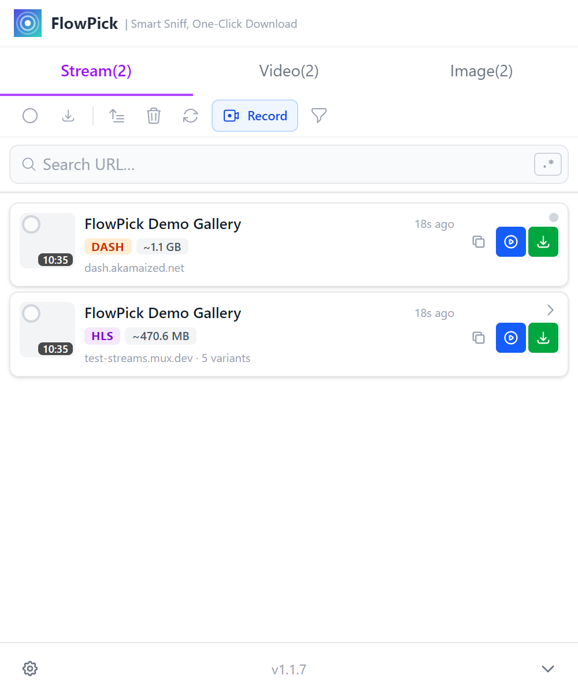
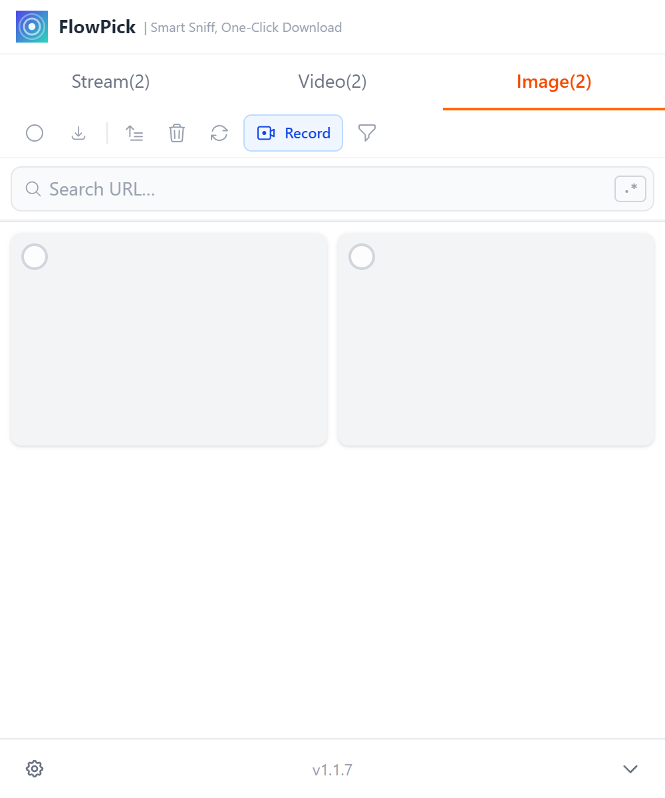
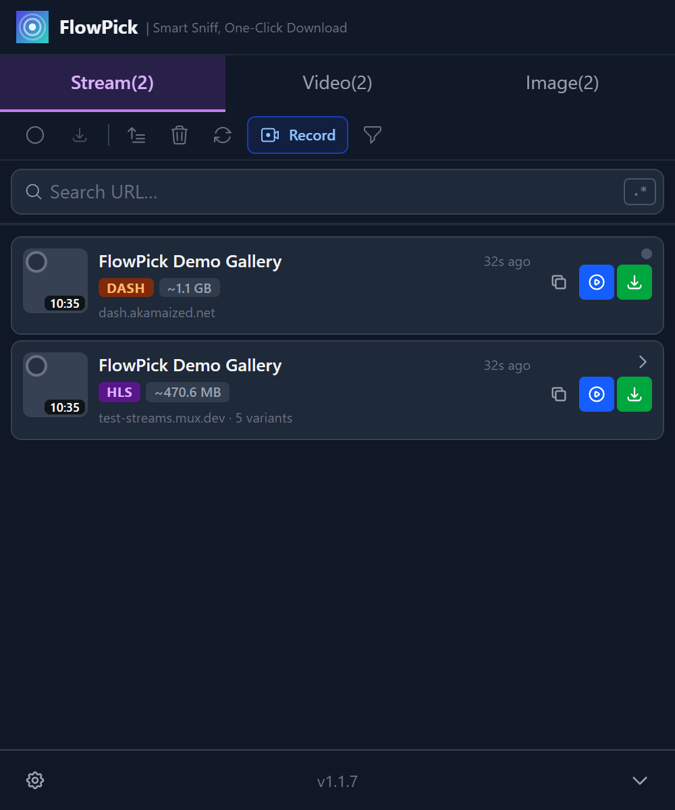
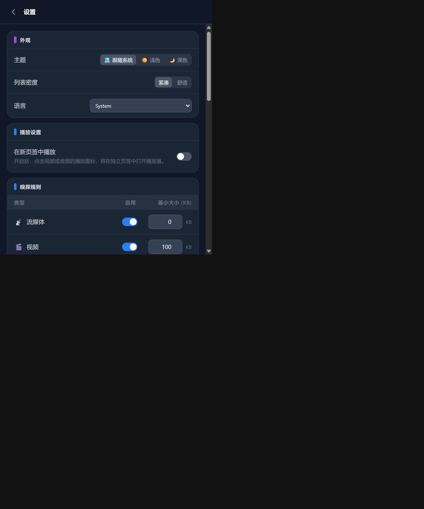
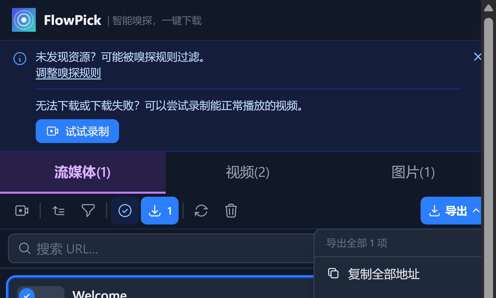
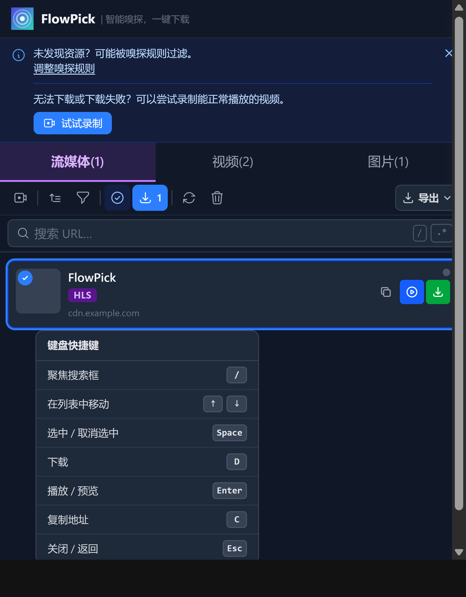
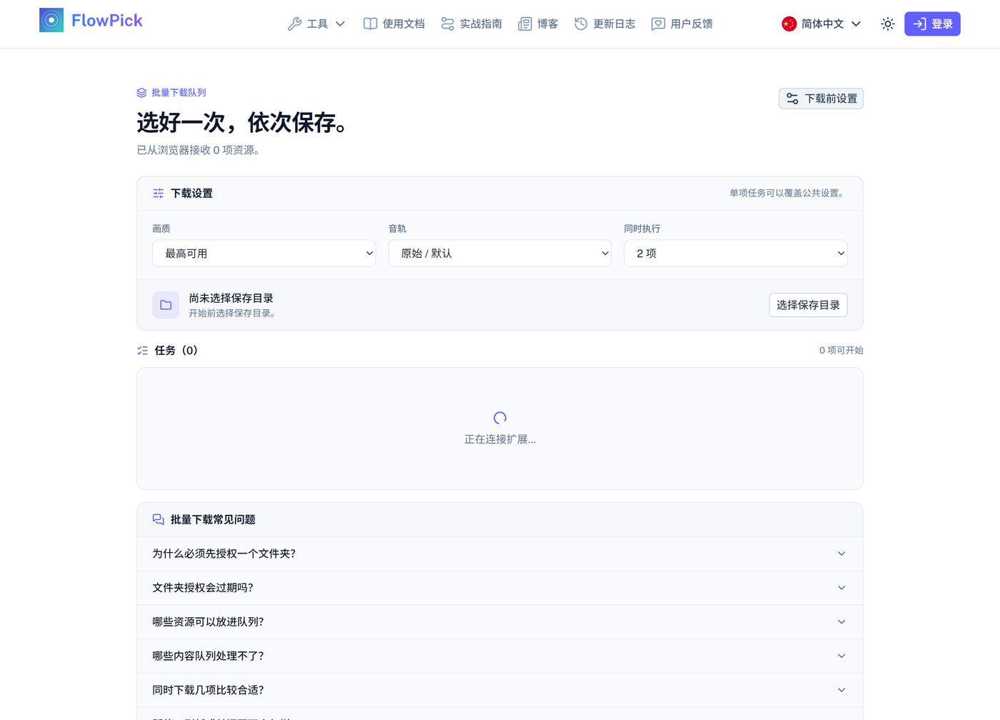

# 🌊 FlowPick

> **智能媒体嗅探 · 一键预览下载** — 自动捕获网页中的视频流、音频、图片等媒体资源，内置播放预览，即嗅即得。

[🇨🇳 中文文档](README_ZH.md) | [🇬🇧 English](README.md)

[](LICENSE)
[](stargazers)
[](#安装)
[](https://flowpick.net)
[](https://flowpick.net/zh-Hans/tools)

> 🧰 **不想装扩展？** 同一项目还提供 20 款免费在线工具 —— [M3U8/HLS](https://flowpick.net/zh-Hans/m3u8-downloader)、[MPD/DASH](https://flowpick.net/zh-Hans/dash-downloader)、[视频](https://flowpick.net/zh-Hans/video-downloader)、[音频](https://flowpick.net/zh-Hans/audio-downloader)下载器，以及剪辑、转换、清单分析与本机 AI 工具，全部在 **[flowpick.net/tools](https://flowpick.net/zh-Hans/tools)**。完整清单见下方「在线工具」章节。

---

## 📸 界面截图

| 流媒体标签页（含清晰度与预估体积） | 图片标签页 |
|---|---|
|  |  |

| 深色主题 | 设置面板 |
|---|---|
|  |  |

| 导出菜单（会跟随选中状态） | 键盘快捷键面板（`?`） |
|---|---|
|  |  |

---

## 🎯 核心功能

### 📡 全能媒体嗅探

四层检测机制，精准捕获网页中所有媒体资源：

| 类型 | 支持格式 |
|------|---------|
| **流媒体** | M3U8 (HLS)、MPD (DASH)、HTTP-FLV、MPEG-TS |
| **视频** | MP4、WebM、MKV、AVI、MOV、WMV、FLV、OGV、3GP、3G2、MPEG |
| **音频** | MP3、M4A、OGA、WEBA、WAV、FLAC、AAC、OGG |
| **图片** | GIF、JPG、PNG、WebP、SVG、BMP、ICO、data: URL (base64) |
| **文档** | PDF 等文档资源 |
| **字幕** | SRT、VTT、ASS 等字幕文件 |

- **网络请求拦截** — 通过 `webRequest` API 实时监控浏览器网络请求
- **Content-Type 优先** — 优先解析响应头 `content-type`，确保格式识别准确
- **URL 模式匹配** — 智能识别 URL 路径与参数中的媒体特征
- **Fetch/XHR 注入** — 注入页面脚本捕获动态加载的媒体请求
- **MSE 流捕获** — 拦截 MediaSource 流数据，捕获无直链 URL 的视频（如部分网页播放器），支持下载已捕获的 MSE 流
- **平台深度适配** — 针对抖音等站点内置专用脚本，解析页面 JSON 数据提取多码率视频/音频候选；通过通用 `PlatformMediaTask` 接口可扩展更多平台

### 🎬 内置播放预览

无需离开插件面板，直接预览播放：

- **流媒体播放** — 内置 HLS.js / DASH.js / mpegts.js 播放器，支持 M3U8、MPD、HTTP-FLV、MPEG-TS 流式播放，自动错误恢复
- **流媒体首帧缩略图** — 自动解码流媒体首帧生成列表缩略图，LRU 缓存 + 并发控制 + 失败重试，列表一目了然
- **HLS 代理加载器** — 通过后台代理 fetch 拉取分片，携带鉴权头与 Referer，突破跨域与防盗链限制
- **DRM 检测** — 自动检测 Widevine / PlayReady 等 DRM 保护内容，提示无法预览
- **直播流录制** — HTTP-FLV / MPEG-TS 直播流可边播边录，达到 500MB 上限自动停止
- **页面录制** — 支持 MSE / MediaRecorder 两种模式录制当前标签页视频，在专用录制页中完成；录制会话持久化，后台 Service Worker 重启后自动恢复
- **音频频谱** — 实时音频频谱可视化，Web Audio API 驱动
- **图片预览** — 全屏灯箱预览，自动识别图片尺寸

### 🔍 智能过滤与筛选

快速定位目标资源：

- **分类标签页** — All / Stream / Video / Audio / Image 一键切换
- **格式过滤** — 按媒体格式精确筛选
- **大小过滤** — 设置最小/最大文件大小范围
- **分辨率过滤** — 按视频分辨率（8K/4K/1080P/720P 等）筛选
- **尺寸过滤** — 按图片宽高筛选
- **正则搜索** — URL 搜索支持普通匹配与正则匹配一键切换，实时校验正则语法
- **时间排序** — 按检测时间升序/降序排列

### ⚙️ 灵活的嗅探规则

精细控制嗅探行为：

- **按类型开关** — 独立控制流媒体/视频/音频/图片/文档/字幕的嗅探启用状态
- **最小捕获大小** — 为每种类型设置最小文件大小阈值，过滤碎片资源
- **域名排除** — 排除指定域名，避免在特定网站上误捕获。填一条即覆盖该域及其所有子域，所以 `example.com` 也会让 `www.example.com`、`m.example.com` 静默（`notexample.com` 不受影响）；也接受 `*.example.com` 和直接粘贴的 `https://example.com/path`
- **隐藏流媒体分片** — 隐藏 HLS/DASH 的 .ts/.m4s 分片，只显示播放列表入口（m3u8/mpd），保持列表整洁
- **data: 图片捕获** — 检测 `` 内嵌的 base64 图片，可配置最小大小过滤 1×1 跟踪像素
- **每标签页条目上限** — 可配置 10–5000 条，超出后自动淘汰最旧条目，避免内存膨胀

### 📊 流媒体清单解析

深入解析 M3U8 / MPD 清单，提取完整元数据：

- **多码率变体** — 列出所有清晰度变体（分辨率 + 码率 + 标签）
- **音频轨道** — 识别分离的音频轨道（EXT-X-MEDIA）
- **总时长估算** — 累加 EXTINF 或解析 MPD 的 mediaPresentationDuration
- **总大小估算** — 优先 byterange 求和，否则多点抽样分片取平均 × 片数（HEAD + Range 探测，省流量）

### 📋 批量操作

- **一键全选** — 快速选中所有媒体项
- **批量下载** — 批量下载选中的媒体文件
- **URL 复制** — 一键复制媒体链接到剪贴板

### 🏷️ 丰富的媒体信息

自动获取并展示：

- **文件大小** — 实时显示媒体文件体积
- **视频分辨率** — 通过原生媒体元数据与流媒体清单解析宽高和分辨率标签
- **音频时长** — 自动获取音频文件时长
- **图片尺寸** — 自动识别图片宽高像素
- **流媒体时长/大小** — 通过清单解析估算 VOD 流的总时长与总大小

### 🌐 其他特性

- **侧边栏模式** — 支持 Chrome Side Panel 与 Firefox Sidebar，提供更宽敞的操作面板，长列表浏览更顺手。弹窗的 ⋯ 菜单里新增 **在侧边栏打开**，不用再靠「点工具栏图标」这个隐藏知识来切换；浏览器拒绝时会明确提示并指向该图标
- **欢迎引导页** — 首次使用提供 6 步图文教程与 9 条常见问题 FAQ
- **下载器页面跳转** — 一键跳转 flowpick.net 对应的下载器（m3u8 / dash / 音频 / 视频）、批量[下载队列](https://flowpick.net/download-queue)或[录制页](https://flowpick.net/recording)，并按浏览器语言自动路由到对应语言版本
- **与官网双向握手** — flowpick.net 页面检测到扩展已安装（`script[data-m3u8-injected]`）后，可把流地址交回扩展下载，见 [useM3u8Ext.ts](utils/useM3u8Ext.ts)
- **标签页隔离** — 每个浏览器标签页独立管理媒体列表
- **Badge 计数** — 扩展图标实时显示当前页面捕获数量
- **外观主题** — 系统 / 浅色 / 深色三种主题自由切换
- **列表密度** — 紧凑 / 舒适两种显示密度
- **多语言** — 支持 23 种语言（英语、简体中文、繁体中文、日语、韩语、德语、西班牙语、法语、俄语、巴西葡萄牙语、意大利语、波兰语、土耳其语、荷兰语、印尼语、越南语、泰语、印地语、乌克兰语、罗马尼亚语、捷克语、匈牙利语、菲律宾语），可跟随系统
- **键盘快捷键** — 三个真实可改键的命令：打开面板（`Alt+Shift+F`）、下载当前页面最佳流媒体（`Alt+Shift+D`）、打开[下载队列](https://flowpick.net/download-queue)（`Alt+Shift+Q`）；设置页显示浏览器实际生效的按键
- **面板键盘导航** — `/` 聚焦搜索、`↑`/`↓` 逐行移动、`Home`/`End` 跳到首尾、`Space` 勾选、`D` 下载、`C` 复制地址、`Enter` 播放/预览、`Esc` 逐层退出（筛选 → 搜索 → 选中）。这些操作在面板里就能看到：搜索框内嵌一个 `/` 键帽，底部的键盘按钮（或直接按 `?`）会打开快捷键面板，每个键都以 `<kbd>` 键帽列出
- **改名会记住** — 点击任意文件名即可改名，自定义名称在关闭面板后依然保留，并用于下载后的文件名
- **复制全部 / 导出** — 工具栏上的 **导出** 按钮直接展开「复制全部 / `.txt` / `.csv`」（名称、地址、格式、分辨率、时长、页面标题）。有选中项时作用于选中项，否则作用于筛选结果，菜单顶部会写明这次导出的条数。按钮文案在所有语言里都刻意只用一个短词（Export、导出、書き出し、Экспорт），因为这排按钮在窄面板里本来就已横向滚动
- **一条工具栏，按用途分组** — 从左到右依次是「选择（全选、下载所选）→ 抓取页面资源（录制、抓取）→ 视图（排序、筛选）→ 列表维护（重新扫描、暂停、清除）」，组与组之间用细分隔线隔开，**导出** 固定在最右侧。全选与下载所选排在最前，因为勾选通常是每次使用时的第一个动作；录制紧随其后，因为页面下载不动时它是兜底方案。所有按钮高度一致，并且同时带有 tooltip 与 `aria-label`；空间不够时这排按钮横向滚动，而不是把某个按钮挤到第二行
- **重新扫描不刷新页面** — 维护区会重新扫描当前页面（含所有 iframe），并重放注入脚本自带的多次重试，因此延迟加载的播放器刚请求的媒体也能被拾取，同时不会丢掉播放进度、滚动位置和页面的登录态。它取代了原先直接 `reload()` 的做法
- **两级暂停** — 「这个标签页」和「所有网站」是两个独立开关，因为一个布尔值表达不了两件事：全局恢复不能顺手把你特意暂停的那个标签页也恢复，单页恢复也不该把整个扩展打开。单页层是给疯狂产出资源的页面踩的刹车——按钮变琥珀色、不写入设置、关掉标签页即遗忘；全局层则是 AdBlock 式的总闸：右键工具栏图标即可暂停所有网站，所有标签页的图标会一起刷成置灰的「禁止」样式
- **三个入口都能暂停** — 页面右键「暂停嗅探此标签页」、工具栏图标右键的总开关、面板工具栏按钮。菜单文案永远和点击后果一致：全局暂停期间，页面右键那一项显示的是「恢复所有网站嗅探」，而不是给一个会被全局层立刻盖掉的单页恢复
- **暂停时角标清零** — 一个红色「12」配一个禁止图标，读起来是「拦截了 12 项」，和暂停的意思正好相反。所以暂停会清空角标，并把图标换成降饱和 + 一道斜杠的版本。两个信号叠加而不是只做一个：16px 下单纯置灰和「加载中」分不清
- **清空需要点两下** — 清空会丢弃整页会话且无法撤销，按钮又紧挨着刷新图标，所以第一次点击只是待命（按钮变实心红），第二次才真正执行；3 秒内没点第二下会自动退出并给出提示
- **清除需要两次确认** — 清除会丢掉当前页面的整段记录且无法撤销，按钮又紧挨着重新扫描，所以第一次点击只是「上膛」（按钮变实心红），第二次才真正执行；3 秒内没有第二次点击会自动撤销并提示
- **不开面板也有媒体信息** — 普通 MP4/WebM 的时长和分辨率直接从文件容器头里读：一个 128 KB 的 Range 请求，不建 `<video>`、不碰 DOM、不新增权限。`moov` 在文件尾的片子只多一次尾部请求，而且同一个响应就带着真实字节长度，嗅探漏掉的体积也一并补上。所以列表一打开就是齐的，不再边滚边填。HLS/DASH 继续走 manifest 估算；设置里的 **后台预取媒体信息** 开关可以整体关掉，关掉后扩展不会主动向媒体服务器发请求
- **下载完成有反馈** — 监听 `downloads.onChanged`，只针对本扩展发起的下载：面板开着时给内联 toast，面板关着时系统通知并带上文件名；失败同样会报告，不再出现「点了开始之后就没了下文」。围绕这段流程设置页还加了两个开关：**下载队列在后台打开**（不再把当前页切走）、**后台预取媒体信息**（控制是否提前探测）
- **DRM 标记** — 播放时发现 DRM 保护后，该行会被打上 `DRM` 标记（悬停有解释），此后点下载会立即给出同样的提示，而不是把用户带进一个注定失败的下载器页面
- **单条删除** — 每张卡片都有一个内联 ✕，**流媒体页也补上了**（视频 / 音频 / 图片 / 文档 / 流媒体都有）。删掉一条流媒体会连同它的各档清晰度一起删，并且该 URL 会在这个标签页里被记住，重新嗅探也不会复活；整页清空仍然是工具栏上的独立按钮
- **空状态会说清原因** — 列表为空有四种完全不同的原因，现在会分别告诉你是哪一种：筛选/搜索把结果藏起来了（给「重置筛选」）、抓到了但被嗅探规则过滤掉了（给「调整嗅探规则」）、站点在排除列表里（给「打开设置」）、或者确实还没检测到（若嗅探已暂停会额外说明）。以前这四种长得一模一样

---

## 🧰 在线工具（免费 · 纯浏览器运行）

下面第一组下载器页面就是扩展"下载"按钮的交接目标，其余是下载之后（或下载不了时）很顺手的独立工具。全部工具入口在 **[flowpick.net/tools](https://flowpick.net/tools)**，免费、无需登录。本地文件类工具全程在浏览器标签页内处理，文件本身不会上传，只有首次使用某个工具时才会拉取对应的解码器 / WASM / AI 模型文件；云端传输是另一个需要手动开启的独立功能。


### 下载媒体 —— 扩展"下载"按钮的跳转目标

在面板里点流媒体 / 视频 / 音频的**下载**按钮时，扩展会打开对应页面，并通过一次性消息通道把地址、文件名、来源页与抓到的请求头传过去（不写进 URL）。

| 工具 | 链接 | 作用 |
|---|---|---|
| **M3U8 下载器** | [flowpick.net/zh-Hans/m3u8-downloader](https://flowpick.net/zh-Hans/m3u8-downloader) | 从公开 `.m3u8` 播放列表选清晰度，在本地合并 HLS 分片 |
| **MPD 下载器** | [flowpick.net/zh-Hans/dash-downloader](https://flowpick.net/zh-Hans/dash-downloader) | 解析 `.mpd` 清单，选择音视频表示层后在本地处理 |
| **视频下载器** | [flowpick.net/zh-Hans/video-downloader](https://flowpick.net/zh-Hans/video-downloader) | 保存 MP4 / WebM / MOV / MKV / FLV 等直链视频 |
| **音频下载器** | [flowpick.net/zh-Hans/audio-downloader](https://flowpick.net/zh-Hans/audio-downloader) | 保存 MP3 / M4A / AAC / WAV / OGG / FLAC 等直链音频 |
| **批量下载队列** | [flowpick.net/zh-Hans/download-queue](https://flowpick.net/zh-Hans/download-queue) | "下载所选"的批量目标；需先授权保存目录，每个窗口最多排队 500 项 |
| **媒体录制** | [flowpick.net/zh-Hans/recording](https://flowpick.net/zh-Hans/recording) | MSE / MediaRecorder 两种录制模式的落点页面 |




### 剪辑与处理

| 工具 | 链接 | 作用 |
|---|---|---|
| **视频剪辑器** | [flowpick.net/zh-Hans/tools/video-trimmer](https://flowpick.net/zh-Hans/tools/video-trimmer) | 精确截取 MP4 / WebM / MOV 中的一段并直接保存 |
| **音频提取器** | [flowpick.net/zh-Hans/tools/audio-extractor](https://flowpick.net/zh-Hans/tools/audio-extractor) | 从视频中提取音轨，保留原音质或转成 MP3 / M4A / WAV / FLAC |
| **音频剪辑器** | [flowpick.net/zh-Hans/tools/audio-trimmer](https://flowpick.net/zh-Hans/tools/audio-trimmer) | 波形视图 + 精确时间点裁剪 |
| **音频音量增强器** | [flowpick.net/zh-Hans/tools/audio-volume-booster](https://flowpick.net/zh-Hans/tools/audio-volume-booster) | 提升偏小的音量、峰值保护、响度归一化，导出 WAV |

### 格式转换

| 工具 | 链接 | 作用 |
|---|---|---|
| **音频格式转换** | [flowpick.net/zh-Hans/tools/audio-converter](https://flowpick.net/zh-Hans/tools/audio-converter) | 在浏览器内转换为 MP3 / WAV / M4A / FLAC / OGG |
| **TS转MP4工具** | [flowpick.net/zh-Hans/tools/ts-to-mp4](https://flowpick.net/zh-Hans/tools/ts-to-mp4) | 把 MPEG-TS / HLS 分片合并为 MP4，支持 AES-128 加密流 |
| **WebM 转 MP4** | [flowpick.net/zh-Hans/tools/webm-to-mp4](https://flowpick.net/zh-Hans/tools/webm-to-mp4) | 把 WebM 录屏转成 H.264/AAC 的 MP4 |
| **WebP 转 MP4** | [flowpick.net/zh-Hans/tools/webp-to-mp4](https://flowpick.net/zh-Hans/tools/webp-to-mp4) | 把动态 WebP 图片转成 MP4 |

### 分析检查

嗅探到的流播放不了、或想确认下载结果到底是什么时很好用。

| 工具 | 链接 | 作用 |
|---|---|---|
| **M3U8 播放列表分析器** | [flowpick.net/zh-Hans/tools/m3u8-playlist-analyzer](https://flowpick.net/zh-Hans/tools/m3u8-playlist-analyzer) | 查看变体、音轨、分片、编码、时长与加密标记 |
| **MPD 清单分析器** | [flowpick.net/zh-Hans/tools/mpd-manifest-analyzer](https://flowpick.net/zh-Hans/tools/mpd-manifest-analyzer) | 解析 DASH 清单的 Period、适配集、表示层、编码、码率、分片寻址与 DRM 元数据 |
| **媒体信息分析器** | [flowpick.net/zh-Hans/tools/video-info](https://flowpick.net/zh-Hans/tools/video-info) | 读取本地文件的封装、编码、码率、分辨率、帧率与轨道信息，可导出 JSON |

### AI 工具（本机推理）

| 工具 | 链接 | 作用 |
|---|---|---|
| **音频转文字** | [flowpick.net/zh-Hans/tools/audio-to-text](https://flowpick.net/zh-Hans/tools/audio-to-text) | 用 Whisper 在本地转写音频，可校对并导出 TXT / SRT / VTT |
| **视频转文字** | [flowpick.net/zh-Hans/tools/video-to-text](https://flowpick.net/zh-Hans/tools/video-to-text) | 直接从视频主音轨生成文字与字幕 |
| **AI 人声分离** | [flowpick.net/zh-Hans/tools/vocal-separator](https://flowpick.net/zh-Hans/tools/vocal-separator) | 用 Kim Vocal 2 把歌曲拆成人声 / 伴奏两轨，各导出一份 WAV |
| **音频降噪** | [flowpick.net/zh-Hans/tools/audio-noise-remover](https://flowpick.net/zh-Hans/tools/audio-noise-remover) | RNNoise 语音降噪，可调干湿比，先试听再处理整段 |
| **音频静音清理** | [flowpick.net/zh-Hans/tools/audio-silence-remover](https://flowpick.net/zh-Hans/tools/audio-silence-remover) | 找出长停顿，可原地静音（保持时长）或直接剪掉 |

### 文档与更新

| 资源 | 链接 |
|---|---|
| 快速开始 | [flowpick.net/zh-Hans/docs/getting-started](https://flowpick.net/zh-Hans/docs/getting-started) |
| 功能文档（嗅探 / 音频 / 图片 / 批量 / 搜索 / 隐私） | [flowpick.net/zh-Hans/docs/features/video-sniffing](https://flowpick.net/zh-Hans/docs/features/video-sniffing) |
| 下载引擎架构 | [flowpick.net/zh-Hans/docs/advanced/download-engine](https://flowpick.net/zh-Hans/docs/advanced/download-engine) |
| 在线工具说明 | [flowpick.net/zh-Hans/docs/advanced/online-tools](https://flowpick.net/zh-Hans/docs/advanced/online-tools) |
| 使用场景（网课 / 直播回放 / 播客 / 图库） | [flowpick.net/zh-Hans/docs/usecases/video-platforms](https://flowpick.net/zh-Hans/docs/usecases/video-platforms) |
| 任务指南 | [flowpick.net/zh-Hans/guides](https://flowpick.net/zh-Hans/guides) |
| 博客 / 更新日志 | [flowpick.net/zh-Hans/blog](https://flowpick.net/zh-Hans/blog) · [flowpick.net/zh-Hans/changelog](https://flowpick.net/zh-Hans/changelog) |
| 反馈 | [github.com/ezwebtools/flowpick/discussions](https://github.com/ezwebtools/flowpick/discussions) |

> 🌏 上面给的是简体中文版链接；把 `/zh-Hans` 换成 `/zh-Hant`、`/ja`、`/ko`、`/fr` 或直接去掉即可切换到对应语言。扩展在打开下载器 / 录制页时会按浏览器 UI 语言自动加前缀。

---

## 📦 安装

### 从商店安装

| 浏览器 | 链接 |
|--------|------|
| **Chrome** | [Chrome 网上应用店](https://chromewebstore.google.com/detail/flowpick-media-sniffer-do/mfinfkkabangbkanlfhhbokgfekjklea) |
| **Edge** | [Edge 加载项](https://microsoftedge.microsoft.com/addons/detail/flowpick-media-sniffer-/egbfhgcifljmeaomlbhggplohemjombb) |
| **Firefox** | [Firefox 附加组件](https://addons.mozilla.org/zh-CN/firefox/addon/flowpick/) |

> 🌐 官网：[flowpick.net](https://flowpick.net)

### 从源码构建

1. 克隆仓库：
```bash
git clone https://github.com/ezwebtools/flowpick.git
cd flowpick
```

2. 安装依赖：
```bash
npm install
```

3. 构建生产版本：
```bash
# Chrome
npm run build

# Firefox
npm run build:firefox
```

4. 加载扩展：
   - **Chrome/Edge**：访问 `chrome://extensions/`，开启「开发者模式」，点击「加载已解压的扩展程序」，选择 `.output/chrome-mv3` 目录
   - **Firefox**：访问 `about:debugging#/runtime/this-firefox`，点击「临时载入附加组件」，选择 `.output/firefox-mv2/manifest.json`

### 开发模式

```bash
# Chrome（热重载）
npm run dev

# Firefox（热重载）
npm run dev:firefox

# 类型检查
npm run compile

# 单元测试（Node.js 内置测试运行器）
node --test tests/
```

> **环境自动切换的站点地址**：托管在官网上的页面（录制页、下载队列、m3u8 / dash / 音频 / 视频下载器）的源地址由 `utils/site.ts` 统一管理 — `wxt dev` 时指向 `http://localhost:3001`，生产构建（`wxt build` / `wxt zip`）时自动指向 `https://flowpick.net`，无需手动切换。开发时请先在本地 3001 端口启动官网 dev server，以保证完整功能可测。

---

## 🚀 使用指南

1. **自动嗅探** — 浏览网页时，FlowPick 自动捕获页面中的媒体请求
2. **查看列表** — 点击扩展图标，查看当前标签页检测到的所有媒体
3. **分类筛选** — 使用标签页和过滤器快速定位目标资源
4. **播放预览** — 点击播放按钮，流媒体/音频直接在面板内播放，图片全屏预览，也可选择在独立标签页中播放
5. **复制链接** — 一键复制媒体 URL
6. **下载文件** — 按资源类型分流：
   - **图片 / 文档 / 字幕** — 由浏览器下载管理器直接保存，自动注入抓到的 Referer 与鉴权头
   - **流媒体、视频、音频** — 在新标签页交给对应的[在线工具](https://flowpick.net/zh-Hans/tools)（M3U8 / MPD / 视频 / 音频下载器）
   - **多选批量** — 送入[批量下载队列](https://flowpick.net/zh-Hans/download-queue)
   - **仅能通过 MSE 播放的播放器、直播流** — 走录制流程后再保存

> 💡 **提示**：部分视频需要先在页面上点击播放，才能被检测到。

> 🔒 **隐私说明**：把资源交给 flowpick.net 页面时，会传递所选资源地址、文件名、来源网页地址，以及复现访问所需的请求头（其中可能包含签名 token、Cookie 或 Authorization）。除非你主动使用云端功能，否则不会上传到服务器。详见[隐私政策](https://flowpick.net/zh-Hans/legal/privacy-policy)。

---

## 🛠️ 技术栈

| 技术 | 用途 |
|------|------|
| [WXT](https://wxt.dev/) | 现代浏览器扩展框架 |
| [Vue 3](https://vuejs.org/) | Composition API 驱动的 UI |
| [TypeScript](https://www.typescriptlang.org/) | 类型安全 |
| [Tailwind CSS](https://tailwindcss.com/) v4 | 原子化样式 |
| [hls.js](https://hlsjs.org/) | HLS 流媒体播放 / 首帧缩略图 |
| [dash.js](https://dashif.org/) | DASH 流媒体播放 / 首帧缩略图 |
| [mpegts.js](https://github.com/xqq/mpegts.js) | HTTP-FLV / MPEG-TS 直播流播放与录制 |
| [m3u8-parser](https://github.com/videojs/m3u8-parser) | M3U8 清单解析 |
| [mpd-parser](https://github.com/videojs/mpd-parser) | MPD 清单解析 |
| [Vite](https://vitejs.dev/) | 构建工具 |

---

## 📁 项目结构

```
flowpick/
├── entrypoints/
│   ├── background.ts       # 后台脚本：嗅探、分组、消息总线、下载交接、代理 fetch、DRM 检测
│   ├── content.ts          # 内容脚本：页面注入、消息中转、MSE 流捕获、官网桥接
│   ├── injected.ts         # 页面世界钩子：fetch/XHR 拦截、播放器（hls.js/dash.js/video.js）绑定、MSE
│   ├── douyin.content.ts   # 抖音平台适配：解析页面 JSON 提取多码率候选
│   ├── player-pick.content.ts # 播放器页面的 MAIN 世界元素拾取
│   ├── popup/              # 弹出面板 UI（同时驱动侧边栏）
│   │   ├── App.vue        # 主组件：列表、播放、设置、录制对话框
│   │   ├── components/
│   │   │   └── SettingsView.vue  # 设置面板组件
│   │   ├── composables/
│   │   │   ├── useMediaFilters.ts      # 筛选/搜索/排序（含正则搜索）
│   │   │   ├── useMediaStore.ts        # 媒体列表状态管理
│   │   │   ├── useMediaViewModels.ts   # 媒体视图模型缓存
│   │   │   └── useStreamThumbnails.ts  # 流媒体首帧缩略图
│   │   ├── utils/
│   │   │   └── hlsProxyLoader.ts       # HLS 后台代理加载器
│   │   ├── types.ts       # 面板共享类型
│   │   ├── main.ts        # 入口
│   │   └── style.css      # 样式
│   ├── player/            # 独立播放页（代替面板内播放，开新标签）
│   ├── sidepanel/         # 侧边栏入口（Chrome Side Panel / Firefox Sidebar）
│   └── welcome/           # 欢迎引导页：教程 + FAQ
├── utils/
│   ├── detect.ts          # 媒体格式检测（Content-Type + URL 模式）
│   ├── settings.ts        # 设置管理（嗅探规则、域名排除、捕获开关）
│   ├── storage.ts         # 标签页媒体列表持久化（session storage）
│   ├── stream-parser.ts   # M3U8/MPD 清单解析（多码率/音轨/时长/大小估算）
│   ├── media-header.ts    # MP4/WebM 容器头读取（时长/分辨率，无需 DOM）
│   ├── sniff-control.ts   # 两级暂停状态（本标签页 / 所有网站）与暂停态工具栏外观
│   ├── platform-media.ts  # 平台适配通用接口（PlatformMediaTask）
│   ├── page-session.ts    # 页面身份与框架世代（跨导航）
│   ├── page-reporter.ts   # 内容脚本到后台的有序确认式媒体事件上报
│   ├── page-media-picker.ts       # 页面元素拾取 / 图片收集
│   ├── player-media-pick.ts       # 播放器清单解析辅助
│   ├── dashjs-media-pick.ts       # dash.js 实例绑定
│   ├── instagram-capture.ts       # Instagram hydration 解析
│   ├── instagram-media.ts         # Instagram 媒体地址归一化
│   ├── instagram-player.ts        # Instagram DASH 轨道提取
│   ├── separated-audio.ts         # 分离音轨与画面同步
│   ├── media-player-tabs.ts       # 播放页会话注册表
│   ├── media-message.ts           # 扩展消息的纯对象克隆
│   ├── download-job.ts    # 遗留下载任务清理：清掉旧版本残留的凭据记录
│   ├── download-queue.ts  # 交给官网的批量下载队列会话
│   ├── native-download.ts # 等待 downloads.download 终态并校验字节数
│   ├── proxy-context-gate.ts      # 按鉴权上下文串行化代理请求
│   ├── privacy.ts         # 请求头捕获策略
│   ├── site-bridge.ts     # 官网桥接的来源/框架白名单
│   ├── recording-bridge.ts        # 录制页与注入脚本间的消息桥接
│   ├── recording-session-store.ts # 录制会话持久化与 Service Worker 重启恢复
│   ├── recording-support.ts       # 录制能力检测（Firefox 不支持）
│   ├── useM3u8Ext.ts      # 官网侧 composable：把流地址交回扩展下载
│   ├── site.ts            # 站点源地址：开发指向 localhost:3001，构建指向 flowpick.net
│   └── i18n.ts            # 国际化与主题/密度管理（23 种语言）
├── tests/                 # 单元测试（Node.js 内置测试运行器）
├── docs/
│   └── screenshots/       # 本 README 用到的截图
├── public/
│   ├── _locales/          # 扩展清单文案（25 个语言目录）
│   └── icon/              # 扩展图标
├── wxt.config.ts          # WXT 配置（权限、Side Panel、Sidebar）
└── package.json           # 项目依赖
```

---

## 🔐 权限说明

| 权限 | 用途 |
|------|------|
| `storage` | 存储检测到的媒体列表（`storage.session`）与用户设置（`storage.local`） |
| `tabs` | 管理标签页级别的媒体列表，打开下载器 / 播放器 / 录制页 |
| `webRequest` | 监控网络请求以检测媒体资源，并缓存 Referer / Cookie / Authorization 供下载与预览重放 |
| `webNavigation` | 跟踪页面与子框架导航，新文档开始时不残留上一页的列表 |
| `declarativeNetRequest` | 会话级规则：为下载与 HLS 代理注入 Referer、剥离 Origin 与缓存相关头（Chromium） |
| `downloads` | 启用文件下载功能 |
| `notifications` | 下载完成等状态通知 |
| `sidePanel` | Chrome 侧边栏模式（仅 Chromium） |
| `tabCapture` | MediaRecorder（MSR）录制标签页模式（仅 Chromium） |
| `<all_urls>` | 在任意页面检测媒体，并访问任意媒体 CDN |

---

## 🌍 浏览器支持

- Chrome / Edge / Chromium（Manifest V3）
- Firefox（Manifest V2）

---

## 🤝 贡献

欢迎贡献代码！请随时提交 Pull Request。

## 📄 许可证

MIT License - 详见 [LICENSE](LICENSE)

## 🙏 致谢

- [WXT](https://wxt.dev/) — 优秀的浏览器扩展框架
- [hls.js](https://hlsjs.org/) — HLS 流媒体播放支持
- [dash.js](https://dashif.org/) — DASH 流媒体播放支持
- [mpegts.js](https://github.com/xqq/mpegts.js) — HTTP-FLV / MPEG-TS 直播流支持
- [m3u8-parser](https://github.com/videojs/m3u8-parser) / [mpd-parser](https://github.com/videojs/mpd-parser) — 流媒体清单解析
- [Tailwind CSS](https://tailwindcss.com/) — 原子化 CSS 框架
